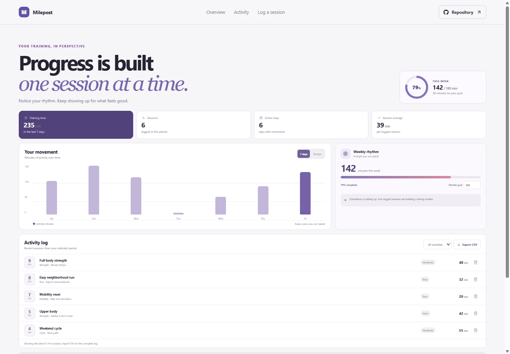

# Milepost: Fitness Progress Dashboard

Milepost turns completed training sessions into a clear view of consistency and weekly movement. It works for walks, runs, strength sessions, yoga, and other workouts.

**Project repository:** https://github.com/a2rp/fitness-progress-dashboard
**Deployed site:** https://a2rp.github.io/fitness-progress-dashboard/

## What is included

- A weekly activity chart and summaries for the selected 7 or 30 day period.
- A personal weekly minutes target with progress indicator.
- A session history with category filtering and date sorting.
- A form for recording an activity, duration, date, effort, and optional note.
- CSV export and a confirmation dialog before removing a session.

## How to use it

Add a completed session in the form below the dashboard. The chart and summaries update from the saved log. Use the period selector and activity filter to review a shorter history. Change the weekly target to match your routine. Choose Export CSV to download the recorded sessions.

## Data and limits

Activity sessions and the weekly goal are saved locally in this browser. They are not synced between devices. The sample entries are demonstration records and can be removed. The dashboard reports activity entered by the user; it does not connect to a watch or calculate medical training advice.

## Run and check locally

Install dependencies with `npm install`, then start the app with `npm run dev`. Use `npm run lint` for ESLint and `npm run build` for the production check. Use `npm run deploy` to build and publish `dist` to the `gh-pages` branch.

## Future improvements

Ideas only. These are not implemented yet:

- Add optional body-measurement trends.
- Add a calendar view with workout scheduling.
- Add import from common fitness file formats.

## Links

- Portfolio: [https://www.ashishranjan.net](https://www.ashishranjan.net)
- GitHub: [https://github.com/a2rp](https://github.com/a2rp)
- CodePen: [https://codepen.io/ash1198](https://codepen.io/ash1198)
- LinkedIn: [https://www.linkedin.com/in/aashishranjan](https://www.linkedin.com/in/aashishranjan)
- Facebook: [https://www.facebook.com/theash.ashish/](https://www.facebook.com/theash.ashish/)
- YouTube: [https://www.youtube.com/@ashishranjan-ashz?sub_confirmation=1](https://www.youtube.com/@ashishranjan-ashz?sub_confirmation=1)
- Email: [mailto:ash.ranjan09@gmail.com](mailto:ash.ranjan09@gmail.com)

## Support

- Support: [https://a2rp-donation-page.netlify.app/](https://a2rp-donation-page.netlify.app/)
- Buy Me a Coffee: [https://buymeacoffee.com/ashishranjan](https://buymeacoffee.com/ashishranjan)
- Patreon: [https://www.patreon.com/ashishranjan](https://www.patreon.com/ashishranjan)